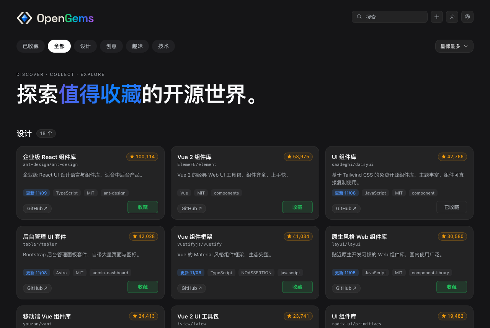

<picture>
  <source media="(prefers-color-scheme: dark)" srcset="assets/opengems-horizontal-dark.svg">
  <source media="(prefers-color-scheme: light)" srcset="assets/opengems-horizontal-light.svg">
  
</picture>

**探索值得收藏的开源世界。** 按主题收集 GitHub 上高星、质量好、说得出一句“它好在哪里”的项目——不要求马上用得上，但要有明确的收录理由。

零依赖的本地应用：一个 Node 进程 + 一个网页，数据是可读的 Markdown 卡片。



## 特性

- **发现**：按分类查询 GitHub，自动过滤低星项目，结果带中文标题与一句话摘要
- **收藏**：一次点击写入 `inbox/`，同时按仓库的 topic 自动归类
- **整理**：详情页里改分类，支持“建议 / 草稿 / 已保存”三种状态，未收藏不会误写
- **回看**：已收藏视图按分类筛选、全文搜索，卡片显示更新日期、语言、协议
- **可读数据**：一张卡片一个 Markdown 文件，`git diff` 就能看出改了什么
- **可选同步**：把数据目录指向任意 Git 仓库，增删改自动提交推送，多机共用一份

## 快速开始

要求 **Node.js 20+**，不需要 `npm install`：

```bash
git clone https://github.com/novbox/OpenGems.git
cd OpenGems
node scripts/collect.mjs
```

打开 <http://127.0.0.1:8899>。macOS 上也可以双击 `OpenGems.command`。

| 场景 | 做法 |
| --- | --- |
| 换端口 | `node scripts/collect.mjs --port 8900` |
| 提高 GitHub 限额 | 复制 `.env.example` 为 `.env`，填 `GITHUB_TOKEN` |
| 停止服务 | `Ctrl+C` 或关闭终端窗口 |

## 使用流程

1. **换一批**：按 `discover.json` 的分类查询 GitHub，结果进入候选池
2. **收藏**：卡片上点收藏，写进 `inbox/`，卡片 front matter 记录 repo、分类、tags、why
3. **整理**：进详情页调整分类——未收藏时是草稿（虚线），收藏后立即生效并同步
4. **回看**：切到“已收藏”，按分类或关键词筛选

分类的自动推导只认明确的 topic 映射：

| topic | 分类 |
| --- | --- |
| `design-systems` / `ui-kit` / `component-library` | 组件库 |
| `animation` / `motion` | 动效 |
| `icons` / `icon-set` | 图标 |

## 数据与同步

默认情况下数据与代码同目录（`inbox/`、`candidates/`、`data/`、`discover.json`）。需要多机共用时，用 `OPEN_GEMS_DATA` 指向一个独立的 Git 仓库：

```bash
git clone <your-data-repo> ~/opengems-data
export OPEN_GEMS_DATA=~/opengems-data
node scripts/collect.mjs
```

同步行为：

- 保存、取消收藏、改分类、换一批之后，2.5 秒去抖自动提交并推送
- 启动时先 `pull --rebase`
- 推送失败会拉一次重推一次，仍失败只记 `lastError`，不改本地文件
- 冲突时 `rebase --abort`，保留本地改动，等下一次或手动处理
- `GET/POST /api/sync` 查看状态、手动同步

数据目录结构：

| 路径 | 作用 |
| --- | --- |
| `inbox/owner--repo.md` | 一张卡片一个文件 |
| `candidates/latest.json` | 候选池缓存 |
| `data/subcategories.json` | 分类索引（从卡片派生） |
| `discover.json` | 分类与查询配置 |

## 配置

`discover.json` 定义分类与查询：

```json
[
  { "id": "design", "label": "设计", "query": "topic:ui-kit stars:>5000", "minStars": 8000 }
]
```

`query` 走 GitHub 搜索语法，`minStars` 是展示下限。改完点“换一批”生效。

## 项目结构

```
scripts/collect.mjs    服务：静态页、API、写卡片、触发同步
scripts/collect.html   前端（单文件，无构建）
scripts/discover.mjs   GitHub 搜索与候选池
scripts/markdown.mjs   README 与卡片的 Markdown 渲染
scripts/title.mjs      中文标题与摘要生成
scripts/review-report.mjs  回顾体检脚本
assets/                logo、favicon、截图
docs/DESIGN.md         设计规范（尺度、控件、配色）
```

没有构建步骤：改 `scripts/collect.html` 后刷新页面即可，服务端改动需要重启进程。

## 设计规范

尺度、控件规格与深浅两套配色见 [docs/DESIGN.md](docs/DESIGN.md)。

## License

[MIT](LICENSE)
